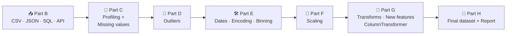
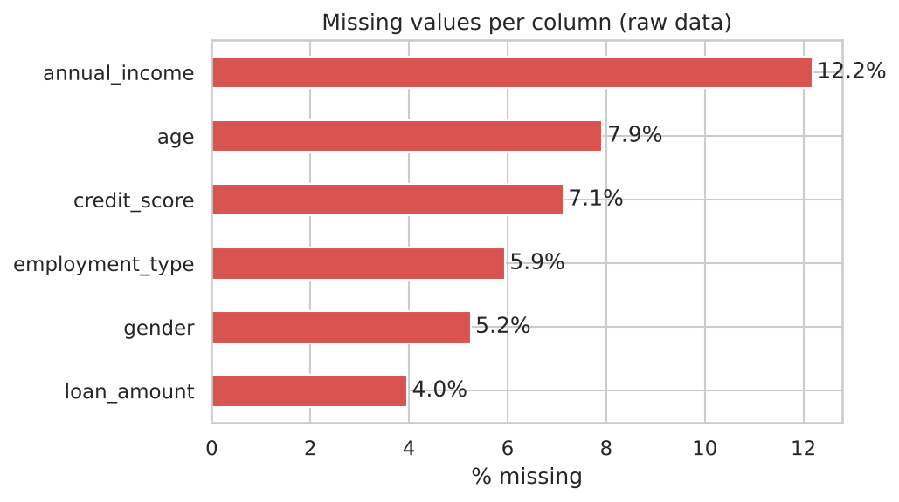
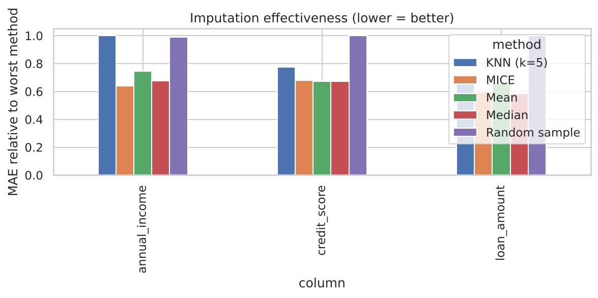
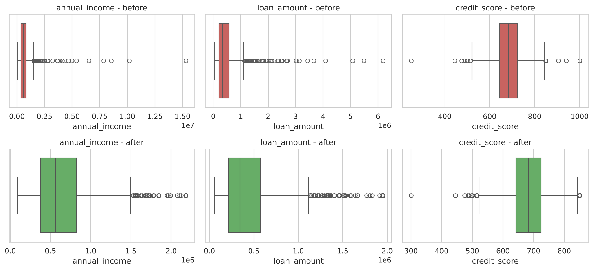
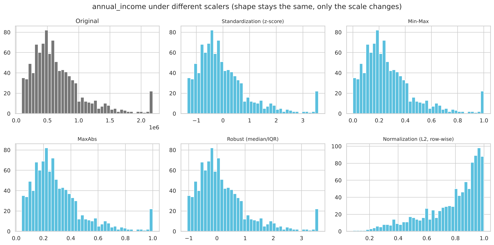
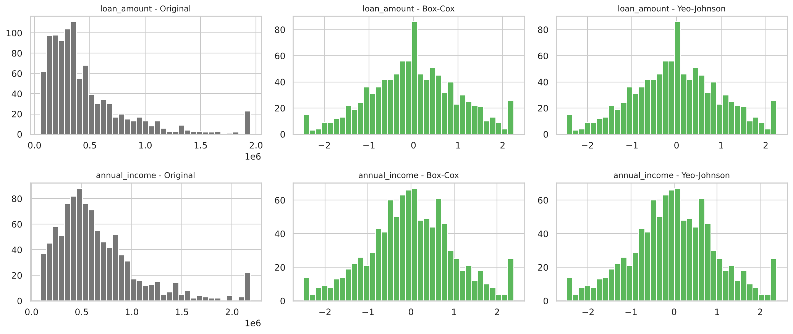
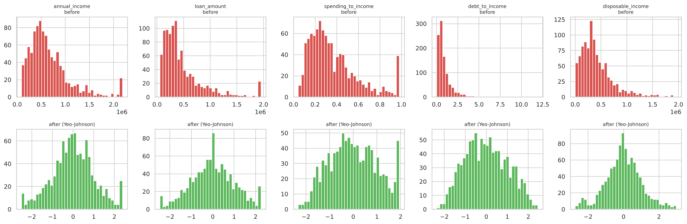
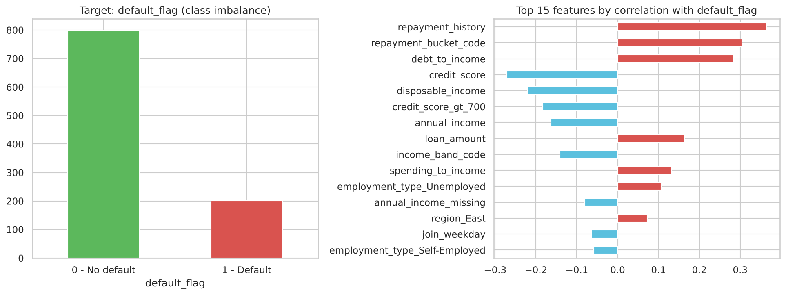

<div align="center">

# Holistic Data Preparer

### End-to-end Data Preprocessing & Feature Engineering for **Customer Credit Risk** Prediction


</div>

---

## 📑 Table of Contents
- [🎯 Objective](#-objective)
- [🏢 Problem Statement](#-problem-statement)
- [🗂️ Project Structure](#️-project-structure)
- [📦 Dataset](#-dataset)
- [🔄 Pipeline Overview](#-pipeline-overview)
- [📊 Key Results](#-key-results)
- [📈 Visualizations](#-visualizations)
- [🧰 Tech Stack](#-tech-stack)
- [✅ Task Coverage](#-task-coverage)
- [📸 Screenshots](#-screenshots)

---

## 🎯 Objective

Take a **raw, messy, multi-source** dataset and turn it into a **clean, numeric, ML-ready** dataset by applying the
complete preprocessing workflow: data understanding → cleaning → imputation → outlier handling → encoding →
scaling → transformation → feature engineering.

## 🏢 Problem Statement

> A fintech company wants to predict **whether a customer will default on a loan**.
> As a **Junior Data Scientist**, I prepared the *Customer Credit Risk* data (collected from CSV, JSON, SQL and an
> external API) so that a Machine Learning model can be trained on it.

| 🎯 Target | `default_flag` → `0` = No default, `1` = Default |
|---|---|
| 🧮 ML task | Supervised **binary classification** |
| ⚖️ Class balance | ~**20 %** defaulters (imbalanced) |

---

## 🗂️ Project Structure

```text
Holistic-Data-Preparer/
│
├── 📁 Data/
│   ├── 📁 Raw/              → Customer.csv · customer.json · customer.sql
│   ├── 📁 External/         → economic_indicators.json  (dummy API response)
│   └── 📁 Processed/        → merged → imputed → cleaned → final_processed_dataset.csv
│                              final_train.csv · final_test.csv · preprocessing_pipeline.joblib
│
├── 📁 Notebooks/
│   ├── 📓 01_Conceptual_Foundation.ipynb     (Part A  – notes + Tensors)
│   └── 📓 02_Holistic_Data_Preparer.ipynb    (Parts B–H – full pipeline)
│
├── 📁 Reports/              → data_quality_report.csv · raw_profiling_report.html
│                              profiling_report.html · final_report.md · summaries (csv)
├── 📁 Visualization/        → 9 charts (PNG)
├── 📁 Screenshots/          → notebook / report screenshots
├── 📁 assets/               → images used in this README
├── 🐍 src/generate_dataset.py
├── 📄 requirements.txt
└── 📄 README.md
```

---

## 📦 Dataset

Synthetic dataset with **1000 customers** collected from **4 sources** (generated with `src/generate_dataset.py`, fixed seed `42`).

| Source | File | What it contains |
|---|---|---|
| 📄 CSV | `Customer.csv` | `customer_id`, `annual_income`, `loan_amount`, `loan_purpose`, `credit_score`, `transaction_count`, `spending_ratio`, `default_flag` |
| 🧾 JSON | `customer.json` | `customer_id`, `age`, `gender`, `region`, `education_level`, `employment_type`, `join_date` |
| 🗄️ SQL | `customer.sql` | `customer_id`, `repayment_history` (missed payments in last 12 months) |
| 🌐 API | `economic_indicators.json` | `region`, `inflation_rate`, `unemployment_rate`, `gdp_growth` |

<details>
<summary><b>🔍 Data problems injected on purpose (click to expand)</b></summary>

| Problem | Where |
|---|---|
| ❓ Missing values | `age` (8 %), `gender` (5 %), `employment_type` (6 %), `annual_income` (12 %), `loan_amount` (4 %), `credit_score` (7 %) |
| 📈 Outliers | `annual_income` (up to ₹1.5 crore), `loan_amount`, `credit_score` (values like 999 / 120 – impossible) |
| 〰️ Skewed columns | `annual_income`, `loan_amount`, `spending_ratio` |
| ⚖️ Category imbalance | `gender` (≈ 68 % Male / 29 % Female / 3 % Other) |
| 📑 Duplicates | 10 duplicate rows |
| 🔤 Mixed variable | `customer_id` = letters + digits (`CUST0042`) |

</details>

---

## 🔄 Pipeline Overview



---

## 📊 Key Results

### ❓ 1. Missing values – which method works best?
10 % of known values were hidden and re-imputed to **measure the error** (Mean Absolute Error, lower = better):

| Method | `annual_income` | `loan_amount` | `credit_score` |
|---|---|---|---|
| Median | 314,005 | **251,988** | **54.5** |
| MICE | **297,270** | 256,798 | 55.0 |
| Mean | 345,438 | 283,221 | 54.5 |
| KNN (k=5) | 464,141 | 295,080 | 62.7 |
| Random sample | 459,948 | 430,746 | 80.9 |

✅ Final choice: **MICE** for income (+ missing-indicator column), **Median** for loan amount & credit score.  
❌ *Complete-case analysis* would delete **364 of 1000 rows (36.4 %)** → rejected.

### 🚨 2. Outliers
| Column | Max before → after | Skew before → after | Treatment |
|---|---|---|---|
| `annual_income` | 1,53,21,000 → 21,85,500 | 8.90 → 1.55 | Winsorization (1 % / 2 %) |
| `loan_amount` | 61,76,300 → 19,51,300 | 4.62 → 1.94 | Winsorization (1 % / 2 %) |
| `credit_score` | 1000 → **850** | – | Clipped to valid range 300–850 |

### 🧬 3. Transformations
| Feature | Skew before | Skew after (Yeo-Johnson) |
|---|---|---|
| `annual_income` | 1.55 | **0.001** |
| `loan_amount` | 1.93 | **0.000** |
| `debt_to_income` | 3.97 | **0.143** |
| `disposable_income` | 1.67 | **0.026** |

On `spending_ratio` the **log** transform worked best; the reciprocal made skewness *worse*.

### ✨ 4. Feature engineering – are the new features useful?
Univariate ROC-AUC against `default_flag` (higher separation = better):

| Feature | Separation | New? |
|---|---|---|
| `repayment_history` | 0.716 | |
| **`debt_to_income`** | **0.692** | ✅ |
| `credit_score` | 0.686 | |
| **`disposable_income`** | **0.657** | ✅ |
| `loan_amount` | 0.616 | |
| `annual_income` | 0.606 | |

💡 `debt_to_income` separates defaulters **better than `loan_amount` or `annual_income` alone**.

### 🏁 5. Final dataset

| Item | Value |
|---|---|
| 📄 File | `Data/Processed/final_processed_dataset.csv` |
| 📐 Shape | **1000 rows × 39 columns** (37 features + `customer_id` + `default_flag`) |
| 🚫 Missing values | **0** |
| 🔢 Non-numeric columns | **0** |
| ✂️ Train / Test | 800 / 200 (stratified, default rate 20.1 % / 20.0 %) |
| 💾 Saved pipeline | `preprocessing_pipeline.joblib` |

---

## 📈 Visualizations

<table>
<tr>
<td align="center"><b>Missing values (raw)</b><br/></td>
<td align="center"><b>Imputation comparison</b><br/></td>
</tr>
<tr>
<td align="center"><b>Outliers – before vs after</b><br/></td>
<td align="center"><b>Scaling comparison</b><br/></td>
</tr>
<tr>
<td align="center"><b>Power transformers</b><br/></td>
<td align="center"><b>Skewness before / after pipeline</b><br/></td>
</tr>
</table>

<div align="center">

**Final dataset overview**  


</div>

---

## 🧰 Tech Stack

| Area | Tools |
|---|---|
| Language | Python 3 |
| Data handling | pandas, NumPy, SQLite (`sqlite3`), `requests`, `json` |
| Preprocessing | scikit-learn (`SimpleImputer`, `KNNImputer`, `IterativeImputer`, `ColumnTransformer`, `PowerTransformer`, `KBinsDiscretizer`, …), SciPy |
| Visualization | Matplotlib, Seaborn |
| Profiling | ydata-profiling (pandas-profiling) |
| Version control | Git & GitHub |

---


## ✅ Task Coverage

<details>
<summary><b>Click to see every task and where it is implemented</b></summary>

| Part | Task | Done | Notebook |
|---|---|:---:|---|
| **A** | 1. Short notes (Data Analysis, Planning a DS project, Framing an ML problem) | ✅ | `01` |
| **A** | 2. Tensors with NumPy (in-depth) | ✅ | `01` |
| **B** | 3. CSV · JSON · SQL · API | ✅ | `02` |
| **C** | 4. `.info()`, `.describe()` | ✅ | `02` |
| **C** | 5. Pandas profiling / data-quality report | ✅ | `02` |
| **C** | 6. Simple, Most-frequent, Missing-indicator + Random sample, KNN, MICE, Complete-case | ✅ | `02` |
| **D** | 7. Z-score, IQR, Percentile, Winsorization | ✅ | `02` |
| **E** | 8. Mixed variables, Date & Time | ✅ | `02` |
| **E** | 9. Ordinal, Label, One-hot encoding | ✅ | `02` |
| **E** | 10. Binning, Binarization, Quantile, K-Means binning | ✅ | `02` |
| **F** | 11. Standardization, Normalization, Min-Max, MaxAbs, Robust | ✅ | `02` |
| **G** | 12. FunctionTransformer, PowerTransformer, ColumnTransformer | ✅ | `02` |
| **G** | 13. Debt-to-Income, Avg monthly transactions, Spending-to-Income | ✅ | `02` |
| **H** | 14. Final cleaned & transformed dataset | ✅ | `02` |
| **H** | 15. Summary report | ✅ | `Reports/final_report.md` |

</details>

---

## 📸 Screenshots

> Add your own screenshots in the `Screenshots/` folder and link them here.

| Notebook output | Profiling report | Final dataset |
|---|---|---|
| `` | `` | `` |

---

<div align="center">

## 👨‍💻 Author

**Manav Patel**
📧 manavpatel.tech@gmail.com
🔗 [GitHub](https://github.com/techmanavp) 

</div>
</div>
