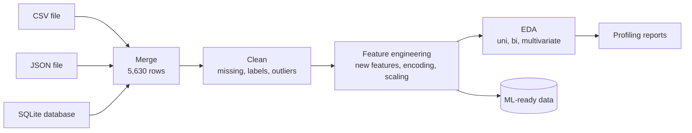
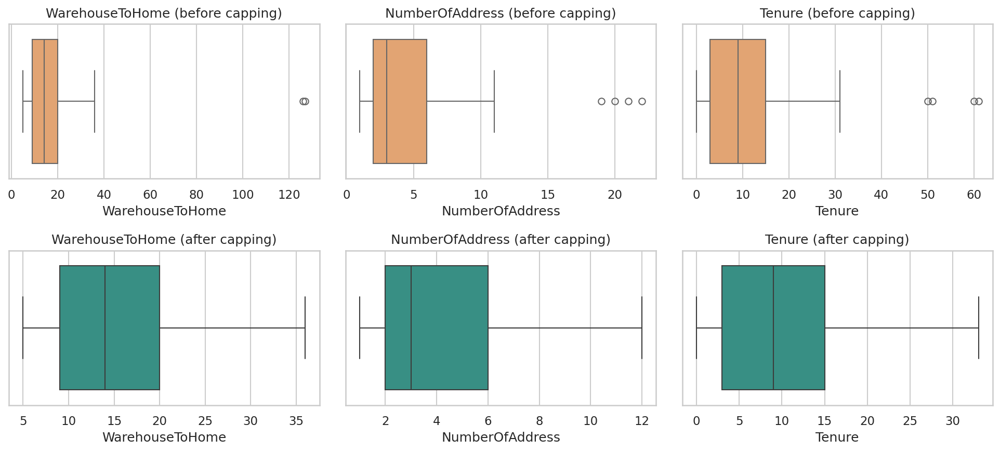
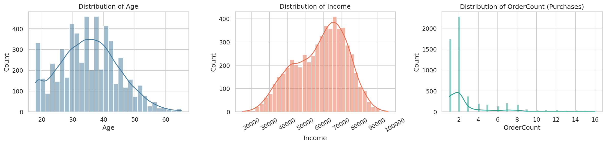
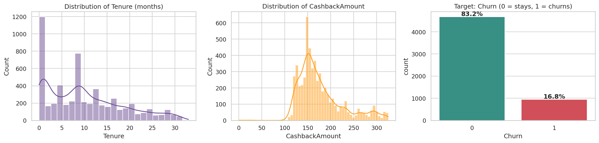
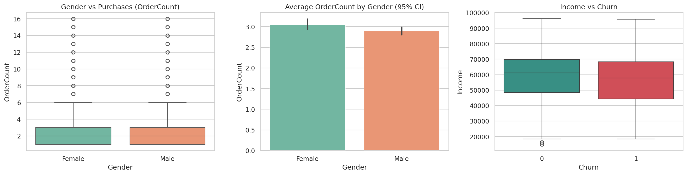
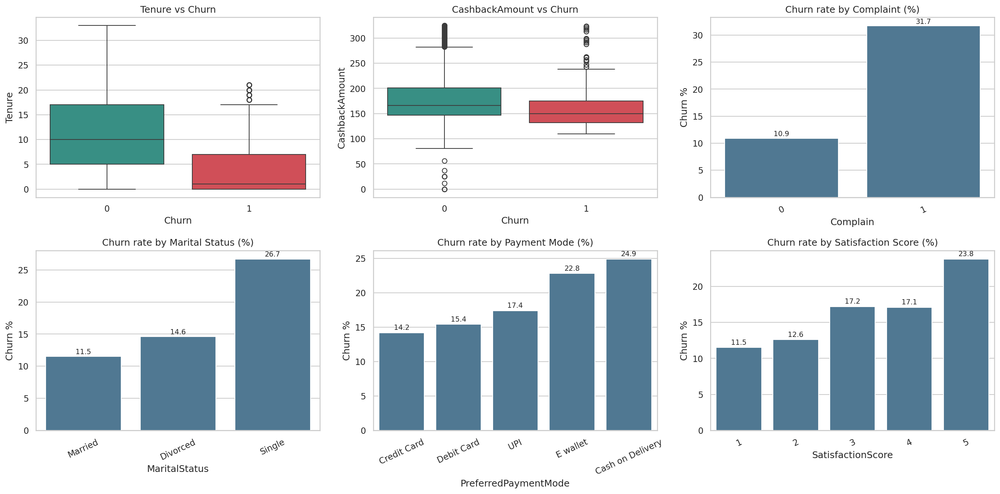
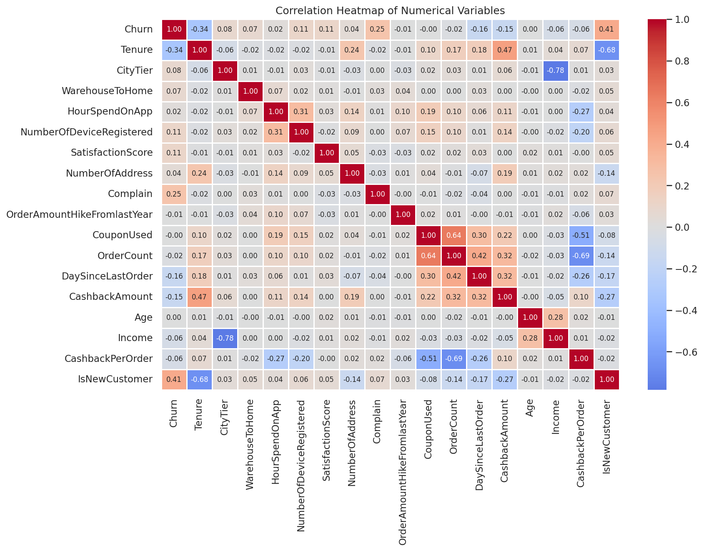
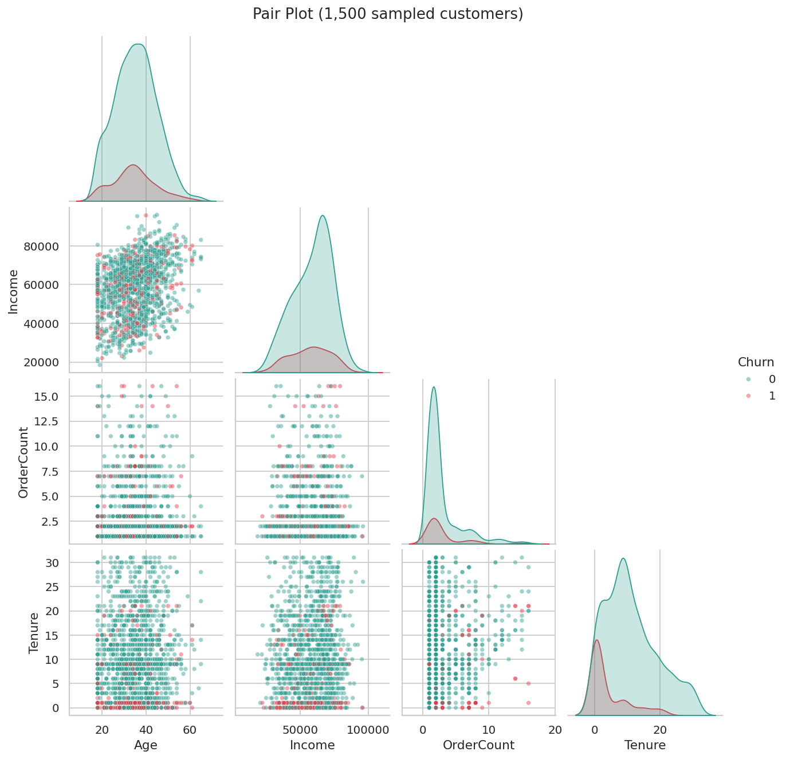

<div align="center">

# Data Preprocessing & Feature Engineering: Customer Churn

Practical-1 project: preparing an e-commerce customer dataset for machine learning, with the goal of **predicting customer churn**.


</div>

---

## 📑 Table of Contents
[Overview](#-overview) · [Problem Statement](#-problem-statement) · [Dataset](#-dataset) · [Workflow](#-workflow) · [Visual Results](#-visual-results) · [Key Insights](#-key-insights) · [Repo Structure](#-repository-structure) · [Author]

---

## 🔍 Overview

An online store is losing customers (**churn**). Before any model can predict who will leave, the raw data has to be **loaded from different sources, cleaned, understood and transformed**. This project does exactly that on a real e-commerce churn dataset of **5,630 customers**.


| 📦 Rows | 🧱 Raw columns | 🧹 Missing cells fixed | 🧬 ML-ready columns | 🎯 Churn rate |
|:---:|:---:|:---:|:---:|:---:|
| **5,630** | **20** | **1,856** | **34** | **~17%** |

---

## 🎯 Problem Statement

| | |
|---|---|
| **Business problem** | Customers leave the platform, reducing revenue. Keeping a customer costs less than winning a new one. |
| **ML task** | Supervised learning, **binary classification** |
| **Target (y)** | `Churn`: `0` = stays, `1` = churns |
| **Features (X)** | Tenure, order count, cashback, days since last order, complaints, satisfaction, gender, age, income and more |
| **Metrics** | Recall, Precision, F1-score, ROC-AUC (plain accuracy is misleading because only ~17% churn) |

---

## 🗂️ Dataset

**E-commerce Customer Churn dataset** from Kaggle: `<PASTE KAGGLE DATASET LINK HERE>`

| Group | Columns |
|---|---|
| 👤 Profile | `Gender`, `MaritalStatus`, `CityTier`, `NumberOfAddress` |
| 🛍️ Purchase behaviour | `OrderCount`, `CouponUsed`, `CashbackAmount`, `OrderAmountHikeFromlastYear`, `PreferedOrderCat`, `DaySinceLastOrder` |
| 📱 Engagement | `Tenure`, `PreferredLoginDevice`, `HourSpendOnApp`, `NumberOfDeviceRegistered`, `PreferredPaymentMode`, `WarehouseToHome` |
| 😊 Feedback | `SatisfactionScore`, `Complain` |
| 🎯 Target | `Churn` |

---

## 🔄 Workflow



---

## 🖼️ Visual Results

### Outlier handling


### Univariate analysis



> Purchases are strongly right-skewed (median 2 orders). Only about **1 in 6 customers churns**, so the target is imbalanced.

### Bivariate analysis



### Multivariate analysis



---

## 🔑 Key Insights

| # | Finding | Evidence |
|:-:|---|---|
| 1 | **New customers are the biggest risk** | Churned customers average **3.9 months** of tenure vs **11.4** for retained ones |
| 2 | **Complaints triple the churn rate** | **31.7%** churn with a complaint vs **10.9%** without |
| 3 | **Single customers churn the most** | Single **26.7%**, Divorced 14.6%, Married 11.5% |
| 4 | **Payment mode matters** | Cash on Delivery **24.9%**, E-wallet **22.8%** vs Credit Card **14.2%** |
| 5 | **Lower cashback goes with churn** | Average cashback **160** (churned) vs **181** (retained) |
| 6 | **Gender barely affects purchases** | Mean orders 3.06 (F) vs 2.90 (M), identical medians |
| 7 | **Strongest correlations with churn** | Tenure **-0.34**, Complain **+0.25** |

---

## 📁 Repository Structure

```
Practical-1/
├── 📄 README.md
├── 📂 Data/
│   ├── 📂 Raw/          original dataset + CSV / JSON / SQLite parts (untouched)
│   ├── 📂 External/     data fetched from the API
│   └── 📂 Processed/    cleaned_churn_data.csv, ml_ready_churn_data.csv
├── 📂 Notebooks/
│   ├── 📓 Part-A.ipynb                        theory and tensors
│   └── 📓 Practical1_Data_Preprocessing.ipynb acquisition → cleaning → EDA → profiling
├── 📂 Report/
│   └── 🌐 cleaned_profiling_report.html
└── 📂 Visualization/    7 saved charts (PNG)
```

| Folder | Meaning |
|---|---|
| `Raw` | Data exactly as received. Never edited, so the pipeline can always be re-run from the start |
| `External` | Data that comes from outside the main dataset (API) |
| `Processed` | Final cleaned and ML-ready data |

---

<div align="center">

## 👨‍💻 Author

**Manav Patel**
📧 manavpatel.tech@gmail.com
🔗 [GitHub](https://github.com/techmanavp) 

</div>